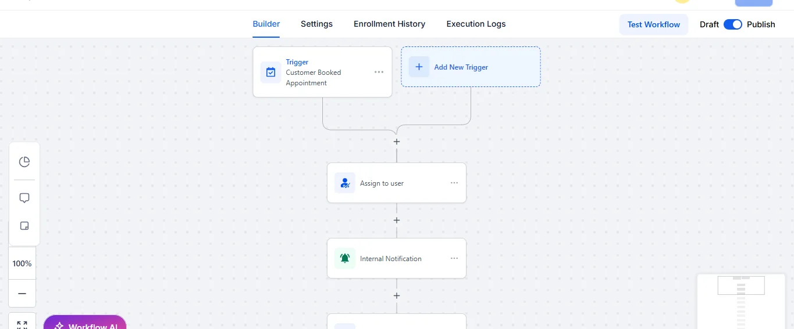

# GoHighLevel CRM and automation

## Work shown

The portfolio includes contact and opportunity organisation, lead and appointment workflows, reputation management screens and branded CRM interfaces.

## Appointment workflow sample

The visible sequence starts when a customer books an appointment, assigns a user and sends an internal notification. These steps give the team an owner and a prompt to act on the booking. Other supplied samples cover reminders, no-shows, routing and membership follow-up.

## Approach

Connect the enquiry to a useful next step: place the lead in the appropriate stage, route the contact, send the relevant reminder and make the next action clear to the operator.

## Evidence

- [Lead and appointment workflows](https://maxtechub.name.ng/portfolio/?project=automation)
- [CRM and marketing operations](https://maxtechub.name.ng/portfolio/?project=crm)
- [Reputation management](https://maxtechub.name.ng/portfolio/?project=reputation)
- [Branded CRM interfaces](https://maxtechub.name.ng/portfolio/?project=whitelabel)

Screenshots demonstrate the available configuration and interface samples. They do not independently establish delivery rates, time saved, revenue generated or a currently running client system.
