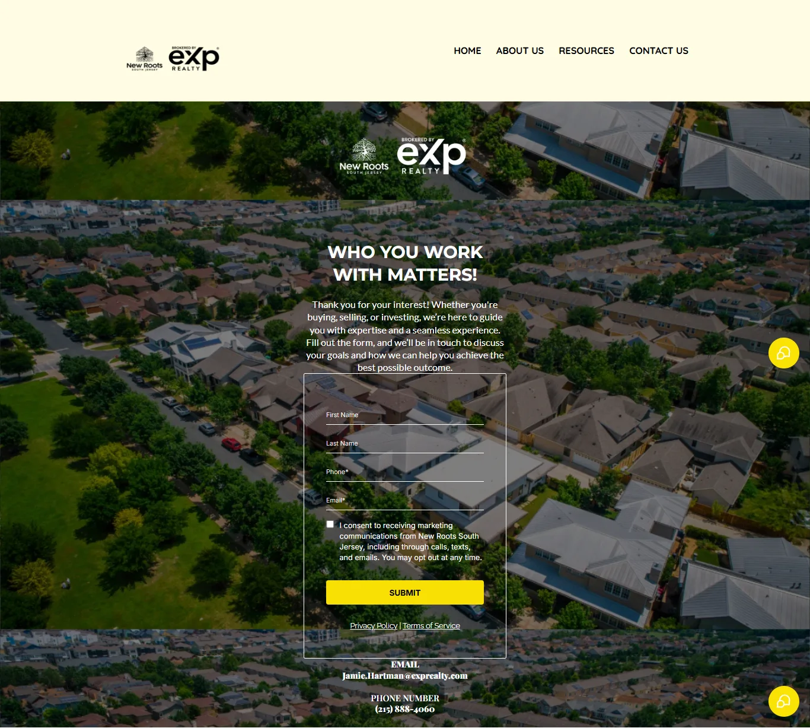

# New Roots South Jersey

**Client:** Jamie Hartman, founder of New Roots South Jersey  
**My role:** Website implementation  
**Client website:** https://www.newrootssouthjersey.com/

## The project

Bring Jamie’s real estate services and enquiry routes into a clear, branded website for prospective buyers and sellers in South Jersey.

I helped build the website. The original work samples below show two parts of that experience: an enquiry page and a compact agent profile page.

## Enquiry page

The page carries the New Roots and brokerage branding, introduces the purpose of the enquiry and places the contact form within the page. The form asks for the visitor’s name, phone number and email address, followed by a marketing-consent checkbox. Public business contact details appear below it.

The visitor can understand the next action without searching through several pages: share their details and start a conversation about buying, selling or investing.

## Agent profile and next steps

The profile brings Jamie’s identity and useful destinations into one place: the website, maps, blog and a call-booking route. It keeps the branding consistent with the main website while giving visitors a shorter route to the information they need.

## Client feedback

**Feedback summary supplied by John, not a verbatim quotation:** Jamie loved the website work and felt the result was more than she had expected.

## What this case demonstrates

Branded website implementation, enquiry-page structure and a connected agent profile. The screenshots document the supplied work samples; no traffic, revenue or conversion increase is claimed without analytics.

[Back to the portfolio](../README.md) · [Discuss a project](https://calendar.app.google/csjf59513gg1Fxji8)
