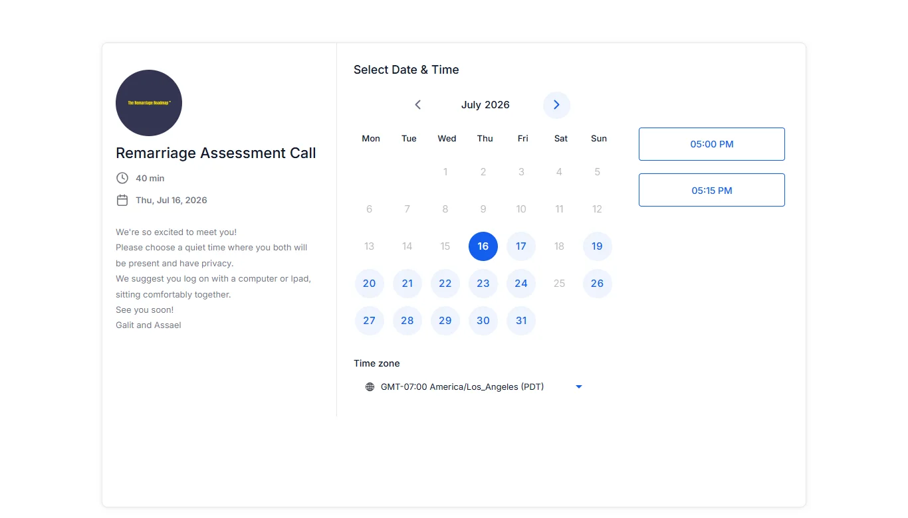

# Potential State

**Client:** Dr. Assael Romanelli and Galit Romanelli  
**My role:** Website implementation and Wix-to-GoHighLevel migration work  
**Client website:** https://potentialstate.com/

## The project

Bring the client’s therapy, training and educational work into a clear website and connected enquiry journey in GoHighLevel. The client supplied an approved design; my contribution focused on implementation and the supporting migration work.

## A booking journey that explains what happens next

The original booking sample shows the Remarriage Assessment Call with its duration, introduction, available dates and appointment times. Visitors can choose a time zone and read practical instructions before proceeding.

This is one part of a wider coaching journey that also includes programme and toolkit pages. It shows how the offer, supporting information and next action can share a coherent visual identity.

## Migration requirements

The migration brief included Home, Therapy and About pages, forms and calendars, contact import, SEO settings, domain work and 77 URL redirect mappings. These details describe the migration scope; the brief alone is not proof that every item was completed.

The visual portfolio brings the original page and workflow samples together so the implementation can be reviewed alongside its intended journey.

## Client feedback

**Feedback summary supplied by John, not a verbatim quotation:** Assael and Galit were pleased with the website, loved the result and felt it brought their work together in a way that made sense to them.

## What this case demonstrates

GoHighLevel page implementation, a branded assessment-booking experience and an understanding of the requirements involved in a website migration. No unsupported conversion or revenue uplift is included.

[Back to the portfolio](../README.md) · [Discuss a project](https://calendar.app.google/csjf59513gg1Fxji8)
